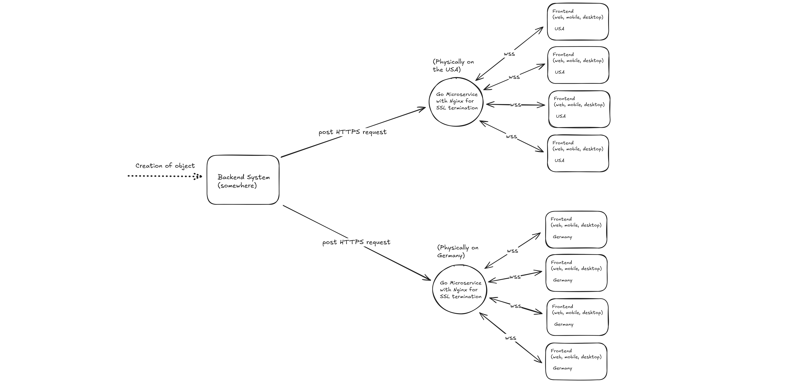

# Real-Time UI Update Microservice

[](https://hub.docker.com/r/slincsilver/real-time-ui-update-microservice)
[](https://hub.docker.com/r/slincsilver/real-time-ui-update-microservice)
[](go.mod)
[](LICENSE)

A plug-and-play Go service that pushes backend events to browsers over WebSockets. Your backend sends one authenticated `POST`, and the service fans the payload out to every subscribed client: all users on a shared channel, or a single user on their own `user:<id>` channel. Your backend never holds a socket, a goroutine or a reconnect loop.

## Features

- **One HTTP call per event**: `POST /update` (authenticated users) or `POST /publish` (public clients) with any JSON body.
- **Channels and scopes**: clients subscribe to named channels; authenticated and public subscribers are fully isolated from each other.
- **Per-user channels**: `user:<id>` only accepts the user whose JWT `sub` is `<id>`, so the backend can notify one user directly.
- **Backend auth without shared long-lived keys on the wire**: HMAC-SHA256 tokens that expire with a configurable time window.
- **Built for fan-out**: no allocation per broadcast, ~16 KiB of memory and a single goroutine per idle connection, and slow consumers are evicted so they never delay anyone else.
- **Production defaults**: graceful shutdown, `/healthz`, HTTP timeouts, origin allowlist, body and frame limits, and an optional pprof listener.
- **Shipped as a signed, minimal image**: multi-arch `scratch` image with SBOM, SLSA provenance and a cosign signature.

## Quick start

### Run the published image

The image is on Docker Hub as [`slincsilver/real-time-ui-update-microservice`](https://hub.docker.com/r/slincsilver/real-time-ui-update-microservice) (`linux/amd64` and `linux/arm64`, tags `1.1.0` and `latest`):

```shell
docker run --rm -p 8080:8080 \
  --read-only --cap-drop=ALL --security-opt=no-new-privileges \
  -e JWT_SECRET=your-jwt-secret \
  -e TIME_TOKEN_SECRET=your-time-token-secret \
  slincsilver/real-time-ui-update-microservice:1.1.0
```

Or with the hardened [`docker-compose.yml`](docker-compose.yml):

```shell
JWT_SECRET=your-jwt-secret TIME_TOKEN_SECRET=your-time-token-secret docker compose up -d
curl -i http://localhost:8080/healthz
```

### Run from source

Requires Go 1.27.3 or newer.

```shell
cat > .env <<'EOF'
JWT_SECRET=your-jwt-secret
TIME_TOKEN_SECRET=your-time-token-secret
TIME_WINDOW_SECONDS=30
EOF
go run ./cmd/server
```

A `.env` file in the working directory is loaded automatically. Real environment variables take precedence.

### Try it with the demo tools

Two small Node.js programs in [`demo-tools/`](demo-tools) simulate both sides:

```shell
# demo-tools/frontend-cli/.env:      WS_URL=ws://localhost:8080/ws  JWT_SECRET=your-jwt-secret  USER_ID=demo-user-123
# demo-tools/backend-simulator/.env: API_URL=http://localhost:8080/update  TIME_TOKEN_SECRET=your-time-token-secret  TIME_WINDOW_SECONDS=30
cd demo-tools/frontend-cli && npm i && npm start        # a browser-like subscriber
cd demo-tools/backend-simulator && npm i && npm start   # a backend publishing events
```

To try a [user channel](#user-channels), pick the authenticated mode in the frontend CLI and subscribe to `user:demo-user-123`, the `USER_ID` it signs into its JWT. Then publish to the same channel from the backend simulator.

## How it works



1. A browser opens a WebSocket to `/ws` (with a JWT) or `/ws/public` and names a channel.
2. When something happens, your backend calls `POST /update` or `POST /publish` with a time token and a JSON body.
3. The service validates the token and queues the payload for every subscriber of that channel. Each payload arrives as its own text frame, byte for byte, in publish order.

Broadcasting runs on the publisher's request goroutine under a read lock, so concurrent publishers proceed in parallel. Each client has its own byte-bounded queue (4 MiB). A writer goroutine exists only while that queue has data, and pings are timer driven, so an idle connection costs one parked goroutine. A client that falls more than 4 MiB behind is closed with `1008` instead of slowing the others.

**Deploying per region:** nodes share no state, so you can run one node close to each user population and terminate TLS in front of it (e.g. Nginx, a cloud load balancer). Your backend then sends a single request per event to each node instead of streaming to every user worldwide. Each node only delivers to clients connected to it, so publish to every node whose users should receive the event.

## API

### Subscribe (clients)

| Endpoint | Auth | Channels allowed |
|----------|------|------------------|
| `GET /ws?token=<JWT>&channel=<name>` | JWT in the `token` query parameter (`HS256`/`HS384`/`HS512`) | shared channels, and the caller's own `user:<sub>` |
| `GET /ws/public?channel=<name>` | none | shared channels only |

```js
const updates = new WebSocket(`wss://rt.example.com/ws?token=${jwt}&channel=orders`);
updates.onmessage = (event) => render(JSON.parse(event.data));
```

- `channel` is optional and defaults to `default`. Channel names are opaque, case-sensitive strings. If the parameter is repeated, the first value is used.
- `401`: missing, invalid, expired or non-HMAC JWT, or a non-string `sub`. Browsers cannot set headers on WebSockets, so an `Authorization` header is ignored.
- `403`: channel not allowed (see [user channels](#user-channels)) or `Origin` not in `ALLOWED_ORIGINS`. Both are rejected before the upgrade.
- Messages sent by clients are discarded. A client frame over 512 bytes closes the connection with `1009`.
- The server pings every 30 s and drops peers that send no pong within 60 s. On shutdown every client receives `1001 going away`.
- The service keeps no history. A client that reconnects, or is evicted with `1008 slow consumer`, should resynchronise from your backend.

### Publish (backend)

| Endpoint | Delivers to |
|----------|-------------|
| `POST /update?channel=<name>` | `/ws` subscribers of the channel, including `user:<id>` channels |
| `POST /publish?channel=<name>` | `/ws/public` subscribers of the channel |

```bash
curl -X POST 'http://localhost:8080/update?channel=orders' \
  -H 'Content-Type: application/json' \
  -H "X-API-Token: $TIME_TOKEN" \
  -d '{"id":"order-123","status":"shipped"}'
```

| Status | Meaning |
|--------|---------|
| `202` | accepted and queued for every current subscriber (also when there are none) |
| `400` | body is not valid JSON, or `/publish` targeted a `user:` channel |
| `401` | missing, malformed or expired `X-API-Token` |
| `413` | body larger than `MAX_BODY_BYTES` |

### User channels

A channel named `user:<id>` belongs to one user. `<id>` must equal the JWT `sub` claim exactly: case-sensitive, with no trimming or normalisation.

| Channel | Who may subscribe |
|---------|-------------------|
| `orders`, `default`, … | any client of the scope |
| `user:42` | only `/ws` clients whose JWT `sub` is `42` |

```bash
# Notify user 42 only; every tab they have open receives it
curl -X POST 'http://localhost:8080/update?channel=user:42' \
  -H 'Content-Type: application/json' \
  -H "X-API-Token: $TIME_TOKEN" \
  -d '{"type":"invoice.paid","invoice":"inv-981"}'
```

- Other users, tokens without `sub` and every `/ws/public` client get `403`.
- The whole id is matched, so ids containing `:`, `|` or `@` (e.g. `auth0|5f7c…`) are safe: user `a` cannot join `user:a:b`. Carry the message kind in the payload rather than in sub-channels.

### Time tokens

Your backend signs the current time window with `TIME_TOKEN_SECRET`:

```
window = floor(unix_seconds / TIME_WINDOW_SECONDS)
token  = base64url( window + ":" + base64url( HMAC-SHA256(TIME_TOKEN_SECRET, window) ) )
```

```js
const crypto = require("crypto");

function timeToken(secret, windowSeconds) {
  const window = Math.floor(Date.now() / 1000 / windowSeconds).toString();
  const mac = crypto.createHmac("sha256", secret).update(window).digest("base64url");
  return Buffer.from(`${window}:${mac}`).toString("base64url");
}
```

A token is accepted for its own window and `ALLOWED_CLOCK_SKEW` windows on either side, so a leaked token stops working once its window passes. Padded and standard-alphabet base64 are accepted too. [`demo-tools/backend-simulator`](demo-tools/backend-simulator/index.js) has a reference implementation.

### Health

`GET /healthz` returns `200` once the server accepts connections, for liveness and readiness probes. The process shuts down gracefully on `SIGTERM`/`SIGINT`.

## Configuration

| Variable | Default | Description |
|----------|---------|-------------|
| `JWT_SECRET` | required | HMAC secret for user JWTs (`HS256`/`HS384`/`HS512` only) |
| `TIME_TOKEN_SECRET` | required | Shared secret for backend time tokens |
| `PORT` | `8080` | HTTP listen port |
| `TIME_WINDOW_SECONDS` | `3600` | Validity window of a time token, must be ≥ 1 |
| `ALLOWED_CLOCK_SKEW` | `1` | Neighbouring windows accepted on each side, must be ≥ 0 |
| `MAX_BODY_BYTES` | `1048576` | Maximum publish payload; larger requests get `413` |
| `ALLOWED_ORIGINS` | any | Comma-separated WebSocket `Origin` allowlist. Requests without `Origin` (non-browser clients) are always allowed |
| `PPROF_ADDR` | off | Address of an optional `net/http/pprof` listener, e.g. `127.0.0.1:6060`. Never expose it publicly |

Invalid values stop the service at startup, with every problem reported at once.

## Security model

- **Backend → service**: time tokens are HMAC-SHA256 over the current window and are compared in constant time. Only the `X-API-Token` header is read, never the query string.
- **Clients → service**: JWTs are verified with an explicit HMAC algorithm allowlist, which rejects `alg: none`, RSA/ECDSA confusion, expired and not-yet-valid tokens.
- **Authorisation**: authenticated and public scopes never share messages. `user:<id>` channels are reachable only by their owner.
- **Limits**: 1 MiB publish bodies (configurable), 512-byte client frames, 32 KiB request headers, a 5 s header read timeout against slowloris, and a 4 MiB per-client queue.
- **Transport**: run behind TLS (WSS/HTTPS) and set `ALLOWED_ORIGINS` to your frontends' origins.
- **Errors**: responses never include secrets, tokens or internals.

## Image security and supply chain

- **Minimal image**: `scratch` base containing only the static binary, running as UID `65532`. There is no shell, package manager or libc to exploit.
- **Pinned build**: the Go builder image is pinned by digest, module checksums are verified against `go.sum`, and the build context is an allowlist of source files.
- **Reproducible**: layer timestamps come from the last commit that touched the build inputs (`SOURCE_DATE_EPOCH`), so rebuilding a commit yields a bit-identical image digest.
- **Scanned before publishing**: `make docker-push` runs `make scan` first. It refuses to publish if `govulncheck` finds a vulnerability reachable from the code, or Docker Scout finds a fixable critical or high CVE in the image.
- **Attested**: every release carries an SBOM and SLSA provenance (max mode):
  ```shell
  docker buildx imagetools inspect slincsilver/real-time-ui-update-microservice:1.1.0 --format '{{json .SBOM}}'
  docker buildx imagetools inspect slincsilver/real-time-ui-update-microservice:1.1.0 --format '{{json .Provenance}}'
  ```
- **Signed**: releases are signed keyless with [Sigstore cosign](https://docs.sigstore.dev/). Verify before deploying:
  ```shell
  cosign verify slincsilver/real-time-ui-update-microservice:1.1.0 \
    --certificate-identity=santiagolhgpro@gmail.com \
    --certificate-oidc-issuer=https://accounts.google.com
  ```
- **Run hardened**: `docker-compose.yml` uses a read-only root filesystem, drops all Linux capabilities, sets `no-new-privileges` and applies memory, CPU and PID limits. `make e2e-image` runs the test suites against the container under the same restrictions.

## Development and testing

```shell
make test        # unit tests with the race detector
make e2e         # end-to-end suites against a race-detector build of the real binary
make e2e-image   # functional and security suites against the Docker image
make perf        # performance scenarios and optimisation report
make bench       # micro benchmarks
make scan        # govulncheck + Docker Scout gate
```

- **Unit tests** cover every package (99–100% statement coverage). They include:
  - time-token interoperability with the Node.js implementation;
  - JWT algorithm-confusion attacks;
  - body limits and the origin policy;
  - framing, ordering, ping/pong liveness, slow-consumer eviction and shutdown;
  - user channel ownership;
  - fuzz targets for token parsing and channel access.
- **End-to-end tests** (`test/e2e`, build tag `e2e`) boot the real binary with throwaway secrets and drive it with simulated backends and browser users:
  - *functional*: fan-out, ordering, payload fidelity, channel, scope and per-user isolation, reconnects, graceful shutdown, configuration validation;
  - *security*:
    - forged, expired and replayed tokens, and scope escalation;
    - user channel access: other users, look-alike and forged subjects, parameter pollution;
    - oversized bodies and headers, the origin allowlist, WebSocket protocol violations;
    - slowloris and connection floods, with goroutine-leak detection;
  - *concurrency*: exactly-once and per-publisher ordering under concurrent publishers, subscriber churn, slow consumers, shutdown under load, and per-user isolation while attackers hammer foreign channels.

  Any data race, panic or unclean exit reported by the server fails the run.
- **Performance suite** profiles the live server through pprof. It writes `test/e2e/reports/perf-<label>.md` with latency percentiles, throughput, memory and goroutines per connection, CPU/allocation/heap hotspots and the optimisation opportunities they point to. `E2E_BINARY` profiles another build and `E2E_PERF_BASELINE` adds a comparison column.

## Performance

These numbers come from the changes the performance suite pointed to. They were measured on an Apple M3 Pro (11 cores) with the load generator on the same host:

| Metric | Before | After |
|--------|-------:|------:|
| Memory (RSS) per idle connection | 31.4 KiB | 16.0 KiB |
| Goroutines per idle connection | 2 | 1 |
| Multi-channel throughput (2000 users) | 237k msg/s | 237k msg/s |
| Multi-channel delivery latency p99 | 4.9 ms | 4.0 ms |
| Fan-out to 2000 users, delivery latency p50 / p99 | 4.5 / 11.7 ms | 4.5 / 10.8 ms |

Throughput is bound by kernel write syscalls (one per delivered frame), so the gains are in memory per connection, allocation pressure and tail latency. A broadcast performs no heap allocation.

## Related services

| Service | Image | Purpose |
|---------|-------|---------|
| [real-time-chat-microservice](https://github.com/SantiagoLopezDeharo/real-time-chat-microservice) | [`slincsilver/real-time-chat-microservice`](https://hub.docker.com/r/slincsilver/real-time-chat-microservice) | JWT-authenticated chat with MongoDB persistence and WebSocket delivery |
| [document-module-microservice](https://github.com/SantiagoLopezDeharo/document-module-microservice) | [`slincsilver/document-module-microservice`](https://hub.docker.com/r/slincsilver/document-module-microservice) | Data format conversion and PDF/DOCX/XLSX document generation |

## License

MIT, see [LICENSE](LICENSE).
